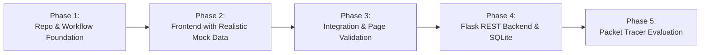

# CampusNet — Project Specification & Requirements

**Project Name:** CampusNet — University Campus Inter-Network Communication and Management System  
**Course Context:** Computer Networks Laboratory (CNL) College Project  
**Authoritative Status:** Active Baseline Specification (Draft v1.0)  

---

## 1. Project Purpose & Academic Scope

CampusNet is a specialized Computer Networks web application designed to model, visualize, and simulate an enterprise-scale university campus network. It enables students, faculty, and network administrators to explore multi-tier network topologies, manage departmental subnetting and IP allocations, and interactively test inter-network access control policies.

> **Academic Boundary Note:**  
> This is strictly a **Computer Networks system**, not a generic university Enterprise Resource Planning (ERP) or Student Information System (SIS). Modules such as student attendance, tuition fees, grading, or course registration are explicitly out of scope.

### Core Networking Concepts Modeled:
- **IPv4 Addressing & Subnetting:** CIDR calculation, subnet masks, network addresses, directed broadcast addresses, and usable host capacity.
- **VLAN Segmentation:** Departmental isolation, virtual local area networks, broadcast domain containment.
- **Switching & Routing:** Layer 2 access/trunk switching vs. Layer 3 Inter-VLAN routing via default gateways.
- **Address Allocation:** Dynamic Host Configuration Protocol (DHCP) simulation vs. static address management.
- **Access Control Lists (ACLs):** Packet filtering rules, firewall policy simulation, port- and protocol-based traffic verdicts.

---

## 2. Planned Application Pages & Detailed Responsibilities

### Page 1: Dashboard (`/dashboard`)
*High-level situational awareness across campus network infrastructure.*

- **Network Metric Cards:**
  - Total Departments & Configured VLANs.
  - Total Monitored Devices (Workstations, Servers, Switches, Routers).
  - Total IP Pool Utilization (Assigned vs. Available).
  - Active Security Alerts / Dropped Packet count.
- **Subnet IP Utilization Monitor:**
  - Visual progress bar for each department's subnet showing percentage of DHCP and Static allocations consumed.
  - Visual threshold warnings when subnet utilization exceeds 85%.
- **VLAN Distribution Breakdown:**
  - Chart displaying device counts across active VLANs.
- **Simulated Event Feed:**
  - Live log of simulated network events: IP lease assignment, static IP configuration, link status change, and blocked packet attempts.

### Page 2: Topology Explorer (`/topology`)
*Interactive canvas modeling physical and logical campus connections.*

- **Interactive Graph Canvas (powered by React Flow):**
  - Custom nodes for Core Routers, Distribution Switches, Access Switches, Lab Workstations, and Data Center Servers.
  - Clear visual styling distinguishing Layer 3 routing links from Layer 2 access/trunk links.
- **Node Inspection Drawer / Modal:**
  - Selecting any node reveals its interface properties: Hostname, Device Type, Assigned IP, Subnet Mask, Default Gateway, MAC Address, Parent Lab/Department, and connected ports.
- **Topology Controls & Filters:**
  - Filter graph visibility by VLAN or department.
  - Zoom-to-fit, pan controls, and minimap navigation.
  - Reset layout button.

### Page 3: Campus Structure & IP Manager (`/ip-manager`)
*Hierarchical management of departments, labs, and device IP leasing.*

- **Campus Hierarchy View:**
  - Tree structure: Campus -> Departments -> Computer Labs -> Connected Workstations.
- **Dual Allocation Engine:**
  - **Dynamic (DHCP-style):** Automatically claims the next sequential free IP in the subnet's DHCP pool range (`.51` - `.254`).
  - **Static:** Allows manual entry within the static allocation pool (`.2` - `.50`).
- **Validation Engine:**
  - Enforces RFC 1918 IPv4 boundary checking.
  - Strictly prevents duplicate IP assignments across the campus.
  - Prohibits assignment of network address (`.0`), default gateway (`.1`), and broadcast address (`.255`).
  - Validates that a device's IP belongs to its department's designated subnet.
- **De-provisioning & IP Release:**
  - Releasing or deleting a device immediately frees its IP address back into the pool.

### Page 4: Communication & Security Center (`/security`)
*Inter-department reachability testing and ACL policy modeling.*

- **Interactive Connectivity Tester (Simulated Ping / Packet Trace):**
  - User selects Source Device and Destination Device (or inputs raw IPs).
  - Selects Protocol (`ICMP`, `TCP`, `UDP`) and Target Port (e.g., `80` HTTP, `443` HTTPS, `22` SSH, `53` DNS).
  - Executes simulation and animates/displays the hop-by-hop packet path.
- **Verdict & Diagnostic Explanation:**
  - Clear **PERMITTED** or **DENIED** badge.
  - Detailed diagnostic message explaining *why* the packet was allowed or dropped (e.g., *"Packet dropped at Core Router: Denied by ACL Rule #3 'Isolate Student WiFi from Admin'"*).
- **Access Control List (ACL) Rule Management:**
  - Table of active rules evaluated in priority order.
  - Ability to add, edit, toggle (enable/disable), and delete simulated ACL rules.
- **Connectivity History Log:**
  - Persistent record of conducted reachability tests with timestamps and results.

---

## 3. Core Data Entities

The application domain is defined by nine core entities (detailed schemas in [`docs/data-model.md`](docs/data-model.md)):

1. **Department:** Administrative academic unit (e.g., Computer Science).
2. **VLAN:** Virtual LAN tag (e.g., VLAN 10) segmenting departmental traffic.
3. **Subnet:** IPv4 address space defining network mask, gateway, and IP pools.
4. **Lab:** Physical or logical computer lab within a department.
5. **Device:** Workstations, campus servers, switches, or routers.
6. **IP Allocation:** Lease record tracking device-to-IP binding and allocation method.
7. **Network Connection:** Link between two network device interfaces.
8. **Access Rule (ACL):** Security filter rule specifying source, destination, protocol, port, and permit/deny verdict.
9. **Connectivity Test:** Result record of a simulated end-to-end packet transmission.

---

## 4. Frontend-First Implementation Plan

CampusNet follows a staged implementation strategy:

- **Phase 1 (Current):** Establish repository foundation, documentation, AI agent instructions, and team workflow.
- **Phase 2:** Build frontend with TypeScript, Vite, Tailwind CSS, React Flow, and realistic mock data (`mockNetwork.ts`).
- **Phase 3:** Integrate all 4 pages into a cohesive user journey and validate all simulation rules.
- **Phase 4:** Develop lightweight Python Flask API and SQLite database to persist state.
- **Phase 5:** Evaluate feasibility of Cisco Packet Tracer `.pkt` file export or PT API integration.

---

## 5. Functional Requirements & Acceptance Criteria

### FR-1: Subnet Calculation Correctness
- **Criterion:** Given any IPv4 CIDR string (e.g., `192.168.10.0/24`), the utility must deterministically return the correct network address, subnet mask, broadcast address, and count of usable hosts.

### FR-2: IP Collision Prevention
- **Criterion:** The IP Manager must reject any attempt to manually assign an IP that is already actively allocated or reserved.

### FR-3: Subnet Boundary Validation
- **Criterion:** Assigning an IP outside the department's subnet range (e.g. attempting to assign `192.168.20.15` to a device in the `192.168.10.0/24` subnet) must trigger an explicit validation error.

### FR-4: Interactive Topology Inspection
- **Criterion:** Clicking any node in the React Flow canvas must open an inspection drawer rendering its hostname, IP, MAC, VLAN, and link status.

### FR-5: Deterministic ACL Evaluation
- **Criterion:** Connectivity tests must evaluate rules sequentially according to priority; the first matching rule must dictate the verdict.

---

## 6. Out-of-Scope Items

To keep the academic project focused and achievable:
- **No live OS packet sniffing:** No promiscuous mode or raw socket packet capture on the host machine.
- **No real DHCP daemon:** The app will not lease IPs to physical machines on the user's home or university WiFi.
- **No university ERP modules:** No student fee processing, attendance logging, or course grading.
- **No complex user authentication during Phase 2:** Login screens and user roles will not block frontend feature development.

---

## 7. Unresolved & Pending Decisions

1. **Cisco Packet Tracer Integration Feasibility:** Pending evaluation in Phase 5 whether Cisco Packet Tracer API or static `.pkt` configuration file generation is required or beneficial.
2. **Department-to-Department Messaging:** Marked as an optional stretch feature in the Communication Center if time permits after core ACL simulation is complete.
3. **State Persistence in Mock Mode:** Deciding whether to back mock state with browser `localStorage` or pure in-memory state during Phase 2.
