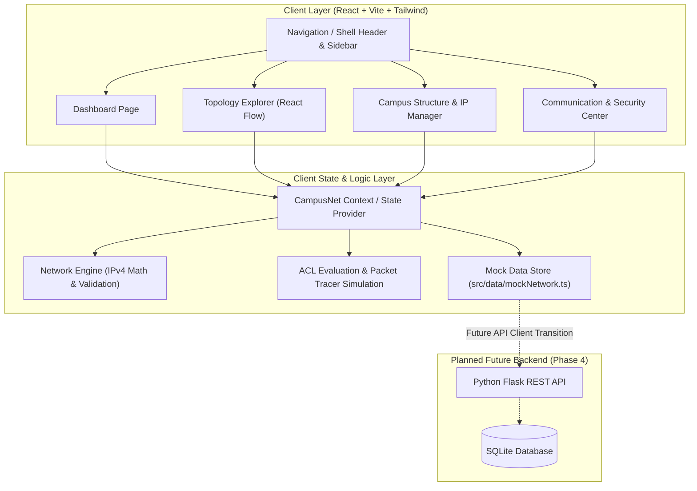

# CampusNet System Architecture

This document describes the planned system architecture, component breakdown, and data flow for **CampusNet**.

> **Note:** All application components and architecture described below represent the **planned design** for implementation starting in Phase 2.

---

## 1. Architectural Overview

CampusNet uses a decoupled, frontend-first client architecture. In the initial phases, all networking validation, state mutation, and topology graph computations execute in the browser using an in-memory mock repository. In later phases, a Python Flask REST service and SQLite database will replace or augment this in-memory layer.

---

## 2. Frontend Component Architecture

### A. Application Shell (`src/layout/`)
- **`AppLayout.tsx`:** Container hosting responsive sidebar navigation, top header (displaying campus simulation status, active department quick-switcher, and reset button), and main content area.
- **`Sidebar.tsx`:** Links to the 4 core views: Dashboard, Topology, IP Manager, Security Center.
- **`Header.tsx`:** Global network summary pills (e.g., total subnets, active nodes, DHCP pool utilization).

### B. View Layer (`src/pages/`)
1. **`Dashboard/`**
   - Summary stat cards (`MetricCard.tsx`)
   - Subnet IP utilization progress bars (`SubnetUtilizationCard.tsx`)
   - VLAN distribution chart (`VlanDistributionChart.tsx` via Recharts)
   - Recent simulated events feed (`EventLogWidget.tsx`)

2. **`Topology/`**
   - Interactive canvas (`TopologyCanvas.tsx` using `@xyflow/react`)
   - Custom React Flow nodes:
     - `RouterNode.tsx`: Core router showing routing interfaces and IP/subnets
     - `SwitchNode.tsx`: Distribution & Access switches showing trunk/access VLANs
     - `HostNode.tsx`: Workstations/PCs showing IP, MAC, and status
     - `ServerNode.tsx`: Department and Campus servers
   - Inspector Drawer (`NodeInspectorDrawer.tsx`): Opens on node selection to show interface configuration, IP lease, and connected links.
   - Filter toolbar (`TopologyFilters.tsx`): Filter visible nodes by VLAN, department, or device status.

3. **`IPManager/`**
   - Department & Lab hierarchy viewer (`DepartmentTreeView.tsx`)
   - Subnet IP Allocation Matrix (`SubnetTableView.tsx`)
   - Allocation modal (`AllocateIpModal.tsx`): Toggle DHCP-style automatic allocation vs. static assignment.
   - Subnet validator warning banner (`SubnetValidationAlert.tsx`).

4. **`SecurityCenter/`**
   - Packet flow test console (`ConnectivityTester.tsx`): Select source node/IP and destination node/IP with target port/protocol (HTTP, SSH, ICMP, DNS).
   - Simulation visualizer (`PacketPathVisualizer.tsx`): Step-by-step trace showing source -> switch -> router -> switch -> destination.
   - ACL Rule Management table (`AclRuleTable.tsx`): Add, reorder, enable/disable access rules.
   - Connectivity test history log (`TestHistoryTable.tsx`).

### C. Shared UI Library (`src/components/common/`)
- Accessible, reusable primitives styled with Tailwind CSS: `Button`, `Input`, `Select`, `Modal`, `Badge`, `Card`, `Table`, `Tabs`, `Alert`.

---

## 3. Core Engine & Logic Layer (`src/utils/`)

To guarantee networking correctness, the client contains a pure-function networking math and validation engine:

### 1. `ipv4Utils.ts` (Subnet & IP Mathematics)
- `ipToLong(ip: string): number` / `longToIp(long: number): string`
- `isValidIpv4(ip: string): boolean`
- `calculateSubnetInfo(cidr: string)`:
  - Network Address (e.g., `192.168.10.0`)
  - Broadcast Address (e.g., `192.168.10.255`)
  - Subnet Mask (e.g., `255.255.255.0`)
  - Usable Host Range (`192.168.10.1` to `192.168.10.254`)
  - Total Usable Hosts (`254`)
- `isIpInSubnet(ip: string, cidr: string): boolean`
- `isReservedIp(ip: string, cidr: string): boolean` (checks network, broadcast, and default gateway)

### 2. `ipAllocationEngine.ts` (DHCP & Static IP Assignment)
- Validates that requested static IP is within usable host range.
- Prevents duplicate IP assignment within the subnet and across the campus.
- Allocates next available IP in the DHCP pool dynamically.
- Releases allocated IP and updates subnet pool statistics.

### 3. `aclEngine.ts` (Policy & Reachability Simulation)
- Evaluates traffic from `(sourceIp, destIp, protocol, port)`.
- Compares against ordered Access Control Rules (first-match evaluation semantics):
  - Matches source CIDR and destination CIDR.
  - Matches protocol and port.
  - Applies action (`PERMIT` or `DENY`).
  - Falls back to default policy (e.g., Implicit Deny or Inter-VLAN Routing Permitted).
- Generates a structured diagnostic explanation for every test result.

---

## 4. State Management Strategy

During Phase 2, state will be managed via a centralized React Context (`NetworkContext`):
- Initializes from `src/data/mockNetwork.ts`.
- Exposes typed state: `departments`, `labs`, `devices`, `subnets`, `vlans`, `connections`, `aclRules`, and `testHistory`.
- Exposes actions:
  - `allocateIp(deviceId, type, requestedIp?)`
  - `releaseIp(deviceId)`
  - `addAclRule(rule)`
  - `toggleAclRule(ruleId)`
  - `runConnectivityTest(sourceId, targetId, protocol, port)`
  - `resetToMockDefaults()`
- Optional persistence: syncs current state to browser `localStorage` so edits survive page refreshes during demonstrations.

---

## 5. Future Backend Integration (Phase 4)

When transitioning to the Python Flask backend:
- The `src/data/mockNetwork.ts` interface contracts will be preserved identically in TypeScript interfaces (`src/types/network.ts`).
- An API service client (`src/services/api.ts`) will replace local state mutations with HTTP `fetch` or `axios` calls.
- SQLite will provide transactional ACID persistence on the backend server.
