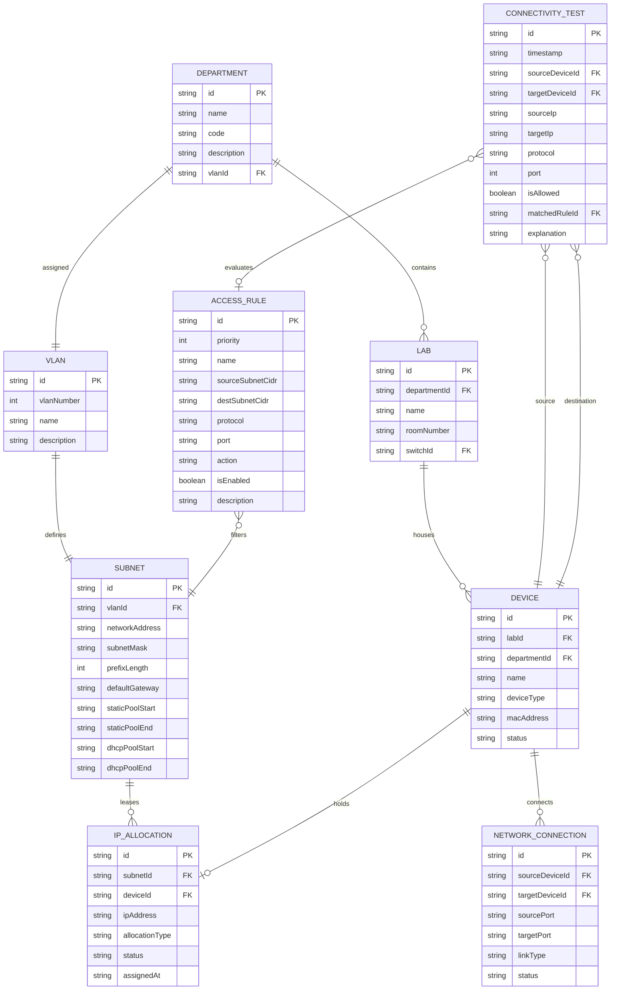

# CampusNet Data Model & Entity Specifications

This document defines the conceptual entities, data types, field schemas, and relationships used across **CampusNet**.

> **Implementation Note:**  
> In the current frontend-first phase, these entities are represented as strongly-typed **TypeScript interfaces** used by the mock dataset and React Context state. In Phase 4, they will map directly to SQLite relational tables.

---

## 1. Entity-Relationship Diagram



---

## 2. Entity Field Specifications & TypeScript Interfaces

### A. Department & VLAN

```typescript
export interface Department {
  id: string;               // e.g. "dept-cs"
  name: string;             // e.g. "Department of Computer Science"
  code: string;             // e.g. "CS"
  description: string;
  vlanId: string;           // FK -> VLAN.id
  building: string;         // e.g. "Engineering Block 2"
}

export interface Vlan {
  id: string;               // e.g. "vlan-10"
  vlanNumber: number;       // e.g. 10
  name: string;             // e.g. "CS_Department"
  description: string;
}
```

### B. Subnet & IP Allocation

```typescript
export interface Subnet {
  id: string;               // e.g. "subnet-10"
  vlanId: string;           // FK -> Vlan.id
  networkAddress: string;   // e.g. "192.168.10.0"
  subnetMask: string;       // e.g. "255.255.255.0"
  prefixLength: number;     // e.g. 24
  defaultGateway: string;   // e.g. "192.168.10.1"
  staticPoolStart: string;  // e.g. "192.168.10.2"
  staticPoolEnd: string;    // e.g. "192.168.10.50"
  dhcpPoolStart: string;    // e.g. "192.168.10.51"
  dhcpPoolEnd: string;      // e.g. "192.168.10.254"
}

export type AllocationType = 'DHCP' | 'STATIC';
export type AllocationStatus = 'ACTIVE' | 'RELEASED' | 'RESERVED';

export interface IpAllocation {
  id: string;
  subnetId: string;         // FK -> Subnet.id
  deviceId: string;         // FK -> Device.id
  ipAddress: string;        // e.g. "192.168.10.55"
  allocationType: AllocationType;
  status: AllocationStatus;
  assignedAt: string;       // ISO 8601 Timestamp
}
```

### C. Lab & Device

```typescript
export type DeviceType = 'workstation' | 'server' | 'switch' | 'router';
export type DeviceStatus = 'online' | 'offline' | 'unallocated';

export interface Lab {
  id: string;               // e.g. "lab-cs-101"
  departmentId: string;     // FK -> Department.id
  name: string;             // e.g. "Advanced Networks Lab"
  roomNumber: string;       // e.g. "E-204"
  switchId?: string;        // Access switch serving this lab
}

export interface Device {
  id: string;               // e.g. "dev-pc-01"
  labId?: string;           // FK -> Lab.id (null for campus servers/routers)
  departmentId: string;     // FK -> Department.id
  name: string;             // e.g. "CS-LAB1-PC01"
  deviceType: DeviceType;
  macAddress: string;       // e.g. "00:1B:44:11:3A:B7"
  status: DeviceStatus;
}
```

### D. Network Topology Connections (Links)

```typescript
export type LinkType = 'ethernet' | 'fiber' | 'trunk';

export interface NetworkConnection {
  id: string;
  sourceDeviceId: string;   // FK -> Device.id
  targetDeviceId: string;   // FK -> Device.id
  sourcePort: string;       // e.g. "GigabitEthernet0/1"
  targetPort: string;       // e.g. "FastEthernet0/24"
  linkType: LinkType;
  status: 'up' | 'down';
  bandwidthMbps: number;    // e.g. 1000
}
```

### E. Access Rules & Connectivity Testing

```typescript
export type AclAction = 'PERMIT' | 'DENY';
export type NetworkProtocol = 'ALL' | 'TCP' | 'UDP' | 'ICMP';

export interface AccessRule {
  id: string;
  priority: number;         // Lower numbers evaluated first (1, 2, 3...)
  name: string;
  sourceSubnetCidr: string; // e.g. "192.168.40.0/24" or "ANY"
  destSubnetCidr: string;   // e.g. "192.168.30.0/24" or "ANY"
  protocol: NetworkProtocol;
  port: string;             // e.g. "80", "22", "53", or "ANY"
  action: AclAction;
  isEnabled: boolean;
  description: string;
}

export interface ConnectivityTestResult {
  id: string;
  timestamp: string;
  sourceDeviceId: string;
  targetDeviceId: string;
  sourceIp: string;
  targetIp: string;
  protocol: NetworkProtocol;
  port: number;
  isAllowed: boolean;
  matchedRuleId?: string;   // FK -> AccessRule.id
  hops: string[];           // Array of device names in trace path
  latencyMs: number;
  explanation: string;
}
```

---

## 3. Data Integrity & Validation Constraints

1. **Unique MAC & IP:** No two active devices may share the same MAC address or IPv4 address.
2. **Subnet Containment:** A device assigned an IP must have an IP within the `Subnet` CIDR assigned to that department's VLAN.
3. **Gateway Protection:** The `.1` address of each subnet is marked as `RESERVED` and cannot be assigned to end devices.
4. **ACL Priority Uniqueness:** ACL priorities should be distinct integers for deterministic evaluation ordering.
