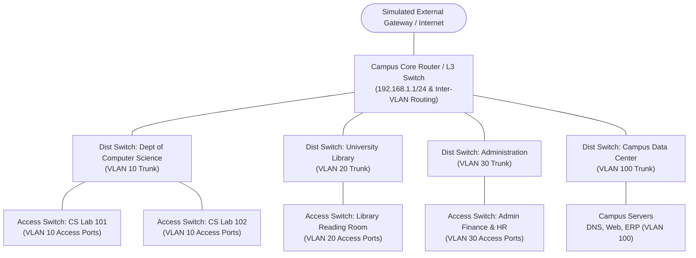

# CampusNet Network Design & Modeling Specification

This document details the logical network topology, IPv4 addressing scheme, VLAN segmentation, routing model, and access-control list (ACL) evaluation policies implemented in **CampusNet**.

> **Important Academic Simulation Disclaimer:**  
> All network behavior, packet transmissions, DHCP leasing, and ACL policy checks modeled in CampusNet represent an **application-level simulation and educational model**. The application does not manipulate real operating system network sockets, does not filter live physical packets, and does not operate an RFC 2131 DHCP server daemon on the host. Any future Packet Tracer integration will be explicitly marked as such.

---

## 1. Campus Network Topology Hierarchy

The campus network is structured following the standard Cisco three-tier hierarchical model simplified for an educational campus environment:



---

## 2. Logical VLAN & Subnet Architecture

The campus network utilizes Private IPv4 address space ([RFC 1918](https://datatracker.ietf.org/doc/html/rfc1918)) with `/24` Class C equivalent subnets per department/functional zone.

| VLAN ID | VLAN Name | Subnet (CIDR) | Subnet Mask | Usable Host Range | Default Gateway | Primary Function |
|---|---|---|---|---|---|---|
| **10** | CS_Department | `192.168.10.0/24` | `255.255.255.0` | `192.168.10.2` – `192.168.10.254` | `192.168.10.1` | Computer Science labs, faculty workstations |
| **20** | University_Library | `192.168.20.0/24` | `255.255.255.0` | `192.168.20.2` – `192.168.20.254` | `192.168.20.1` | Digital library PCs, catalog terminals |
| **30** | Campus_Admin | `192.168.30.0/24` | `255.255.255.0` | `192.168.30.2` – `192.168.30.254` | `192.168.30.1` | Accounts, registrar, HR workstations |
| **40** | Student_WiFi | `192.168.40.0/24` | `255.255.255.0` | `192.168.40.2` – `192.168.40.254` | `192.168.40.1` | Student personal devices and guest access |
| **100** | Data_Center | `192.168.100.0/24` | `255.255.255.0` | `192.168.100.2` – `192.168.100.254` | `192.168.100.1` | Campus DNS, intranet portal, student database |

*Note: The subnet allocations above are realistic defaults and can be reconfigured or customized in the application.*

---

## 3. IP Allocation Policy (DHCP vs. Static)

Each subnet reserves distinct ranges for static infrastructure versus dynamic DHCP assignment to avoid IP conflicts:

```text
Subnet: 192.168.10.0/24
├── 192.168.10.0       -> Network Address (Reserved, cannot be assigned)
├── 192.168.10.1       -> Default Gateway (Core Router Virtual Interface / SVI)
├── 192.168.10.2 - .50  -> Static Allocation Pool (Department switches, printers, local servers)
├── 192.168.10.51 - .254-> Dynamic DHCP Pool (Lab workstations, student PCs)
└── 192.168.10.255     -> Subnet Directed Broadcast Address (Reserved)
```

### Allocation Rules:
1. **Gateway Reservation:** `.1` of each subnet is strictly reserved for the default gateway.
2. **Boundary Enforcement:** Any IP smaller than `192.168.x.2` or larger than `192.168.x.254` is rejected.
3. **Collision Detection:** Attempting to assign an IP currently leased to another device triggers a validation error.
4. **Subnet Affinity:** A device belonging to Lab 101 (CS Dept, VLAN 10) cannot be assigned an IP belonging to VLAN 20 (`192.168.20.0/24`).

---

## 4. Switching & Routing Assumptions

1. **Intra-VLAN Switching (Layer 2):**
   - Devices within the same VLAN (e.g., two PCs in CS Lab 101) communicate directly via Layer 2 switching without hitting the router gateway.
   - Traffic is contained within the broadcast domain of that VLAN.

2. **Inter-VLAN Routing (Layer 3):**
   - Communication between different VLANs (e.g., CS Lab PC `192.168.10.55` to Data Center Server `192.168.100.10`) must traverse the Core Router / Layer 3 Switch.
   - The Core Router acts as the default gateway for each VLAN and applies Access-Control Lists (ACLs) before forwarding packets.

---

## 5. Security & Access Control List (ACL) Model

CampusNet models simulated packet inspection using **Extended Access-Control Lists (ACLs)** evaluated at the Core Router:

### A. Rule Evaluation Semantics
- Rules are evaluated sequentially in **ascending priority order** (Priority 1 is evaluated first).
- **First-Match Policy:** The first rule whose condition matches the packet (Source Subnet, Destination Subnet, Protocol, Port) determines the verdict (`PERMIT` or `DENY`).
- **Default Policy (Fallback):** If no explicit rule matches:
  - If Inter-VLAN isolation is enabled: `DENY` (Implicit Deny).
  - Standard academic baseline: `PERMIT` for intra-campus general traffic, unless specifically restricted.

### B. Standard Initial ACL Policies (Simulated Baseline)

| Priority | Rule Name | Source | Destination | Protocol / Port | Action | Purpose |
|---|---|---|---|---|---|---|
| 1 | Allow DNS to Campus Server | `ANY` | `192.168.100.10/32` | UDP 53 (DNS) | **PERMIT** | All campus hosts can resolve internal names |
| 2 | Allow Web to Campus Portal | `ANY` | `192.168.100.20/32` | TCP 80, 443 (HTTP/S) | **PERMIT** | Campus intranet access |
| 3 | Isolate Student WiFi from Admin | `192.168.40.0/24` | `192.168.30.0/24` | ALL | **DENY** | Prevent student devices accessing admin machines |
| 4 | Block Student Access to Server SSH | `192.168.40.0/24` | `192.168.100.0/24` | TCP 22 (SSH) | **DENY** | Protect campus servers from untrusted SSH |
| 5 | Allow CS Dept to Server Farm | `192.168.10.0/24` | `192.168.100.0/24` | ALL | **PERMIT** | CS labs have lab server access |
| 6 | Default Inter-VLAN Allow | `192.168.0.0/16` | `192.168.0.0/16` | ICMP (Ping) | **PERMIT** | General ICMP diagnostic reachability |

---

## 6. Connectivity Simulation Engine

When a user initiates a connectivity test between Source Device $S$ and Destination Device $D$:
1. **Resolve IPs:** Check if $S$ and $D$ have valid, active IP addresses assigned.
2. **Subnet Check:**
   - If `source.subnet == dest.subnet`, intra-VLAN path is simulated; direct Layer 2 delivery is permitted unless host is offline.
   - If `source.subnet != dest.subnet`, packet is routed via Core Router gateway.
3. **ACL Evaluation:** Core Router evaluates the packet header against the ACL rule table.
4. **Verdict Generation:** If permitted, return path hops (e.g., `Host -> Access Switch -> Core Router -> Server Switch -> Server`) with simulated latency. If denied, return the exact ACL rule ID and explanation.
